# Hotel guide

Everything your team needs to run guest services: set-up, daily work and fixes. The same guide is inside the app (Help & guide).

<!-- Generated from modules/help/content.ts by `pnpm guide:md`. Edit the content there, not here. -->

## Where to start

1. [Add property & rooms](#property-setup) — Floors, room types, rooms
2. [Services & design](#services) — What guests can ask for, and the look
3. [Print QR codes](#qr-codes) — One sticker per room
4. [Invite staff](#staff) — A login and role for each person
5. [Check guests in](#front-desk) — Front desk
6. [Handle requests](#requests) — Accept → Start → Complete

## Contents

- **Start here**
  - [How the system works](#getting-started)
  - [First-time setup checklist](#setup-checklist)
- **Set up your hotel**
  - [Properties, floors, room types and rooms](#property-setup)
  - [Room QR codes](#qr-codes)
  - [Services and menus](#services)
  - [Guest page: information, design and photos](#guest-page)
  - [Staff and roles](#staff)
- **Daily work**
  - [Reservations](#reservations)
  - [Check-in and check-out](#front-desk)
  - [Guest bills and orders](#bills)
  - [Handling guest requests](#requests)
  - [Housekeeping](#housekeeping)
  - [Room statuses (automatic)](#statuses)
  - [What the guest sees](#guest-view)
- **Manage the business**
  - [Reports and audit log](#reports)
  - [Your plan and account status](#billing)
  - [Hotel settings and integrations](#hotel-settings)
- **Your account**
  - [Your profile, password and notifications](#my-account)
- **Help**
  - [Problems and quick fixes](#faq)

---

## Start here

### How the system works

*Guests scan a QR code in their room, ask for things, and your team handles them from one Requests list.*

**Shown to:** Everyone

Every room has its own QR code. A guest scans it with the phone camera (no app, no login), sees your hotel page and sends requests such as water, towels, food or a repair. The request reaches the right department straight away, and the guest watches its progress live.

| Who | Where they work | What they do |
| --- | --- | --- |
| Owner / manager | Dashboard, Properties, Staff, Billing | Set up the hotel, rooms, QR codes, services, design and staff |
| Receptionist | Front desk, Reservations, Requests | Bookings, check-in/out, guest bills, reception requests |
| Housekeeping | Housekeeping, Requests | Clean rooms after checkout, towel and cleaning requests |
| Room service | Requests | Food and drink orders |
| Maintenance / Security | Requests | Repairs, problems and safety requests |
| Guest | Room QR page | Hotel info, Wi-Fi, requests, orders |

> **Tip:** You only see the menus and guide sections your role needs. If something is missing, ask your hotel owner to check your role on the Staff page.

▶ **[Video: a quick tour of every menu](../public/guide/video-tour.webm)** (video, no sound)

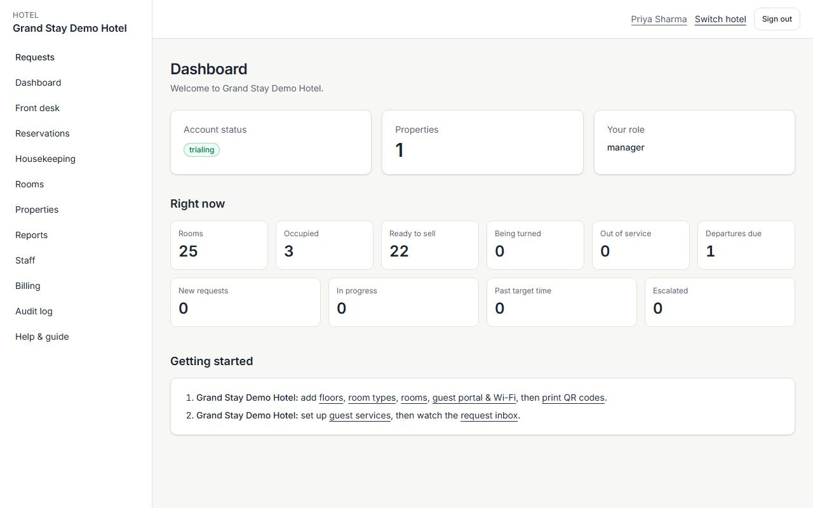
*The Dashboard after signing in*

### First-time setup checklist

*The order to set up a new hotel, about 30 minutes in total.*

**Shown to:** Hotel Owner, Hotel Manager

1. **Add your property**: Properties → Add property (name, address, timezone, currency).
2. **Create floors and room types**: open the property → Floors tab, then Room types tab.
3. **Add rooms**: Rooms tab → Add room, or the bulk form for a whole floor (for example 101 to 120).
4. **Check departments and services**: Departments and Services tabs. Defaults are created for you.
5. **Fill in guest information**: Guest portal tab (Wi-Fi, reception phone, check-in/out times, welcome message).
6. **Design the guest page**: Design & photos tab (template, colours, logo, cover and gallery photos).
7. **Create and print QR codes**: QR codes tab → create missing codes → Print.
8. **Invite your team**: Staff → Invite a staff member, then send each person their link.
9. **Test it**: scan one QR code with your phone and send a request. It should appear under Requests.

Open in the app: [Open Properties](https://hotel-qr-code-saas.vercel.app/properties) · [Open Staff](https://hotel-qr-code-saas.vercel.app/staff)

---

## Set up your hotel

### Properties, floors, room types and rooms

*Build the room structure: rooms need a floor and a room type first.*

**Shown to:** Hotel Owner, Hotel Manager

1. Go to **Properties** and click **Add property**. Each property has its own timezone, currency and rooms. A hotel group can add several.
2. Open the property. In the **Floors** tab add each floor (Ground, 1st, 2nd…).
3. In the **Room types** tab add each type with its capacity (Standard, Deluxe, Suite…).
4. In the **Rooms** tab click **Add room**: room number, floor and room type. Use the bulk form on the same page to add a whole range at once.
5. Open the **Departments** tab to check which teams receive requests (Reception, Housekeeping, Room service, Maintenance, Security).
6. Use the **Settings** tab to change the property's name, address, timezone and currency later.

> **Tip:** A new room starts clean and Ready, so you can check a guest into it straight away.

To take a room out of use (renovation, broken AC), open the room and set its status to **Out of order**, **Maintenance** or **Inactive**. It can't be checked into until you set it back to **Active**.

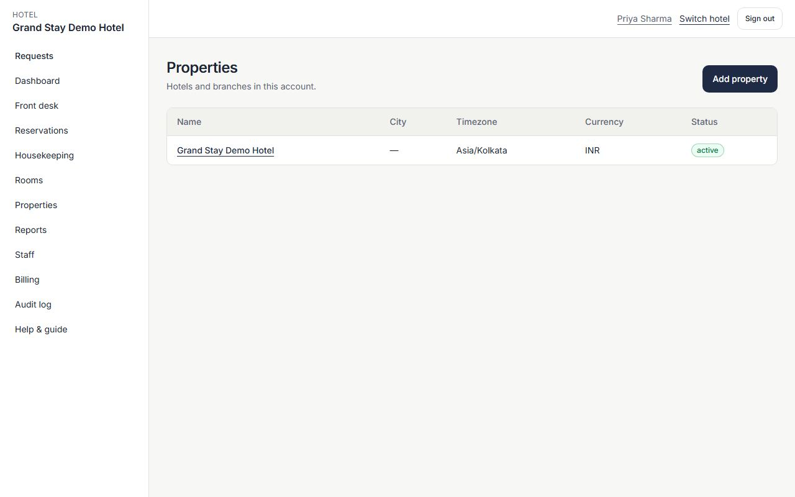
*Properties list*

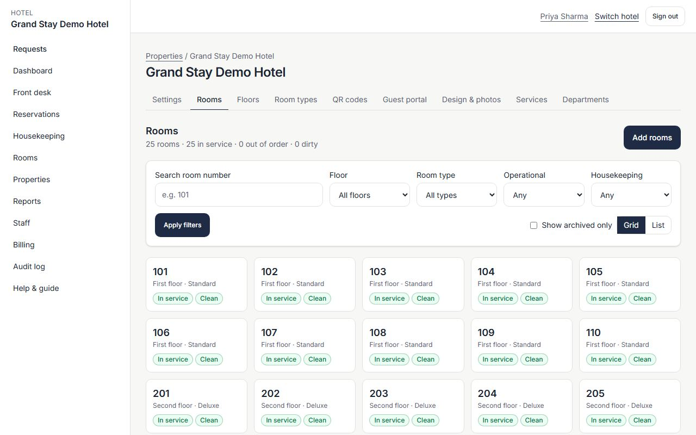
*A property's Rooms tab with floors, types and statuses*

Open in the app: [Open Properties](https://hotel-qr-code-saas.vercel.app/properties) · [Open Rooms](https://hotel-qr-code-saas.vercel.app/rooms)

### Room QR codes

*Create, print and look after the QR sticker in every room.*

**Shown to:** Hotel Owner, Hotel Manager, Receptionist

1. Open the property → **QR codes** tab.
2. Click the button to create codes for every room that doesn't have one yet.
3. Click **Print** for a printable sheet with the room number under each code. Print on sticker paper or cards.
4. Place each code in its own room (bedside table, desk or back of the door).
5. Scan one with your phone to check it opens the right room.

| Action (room page → QR card) | When | What happens |
| --- | --- | --- |
| Download | One sticker is damaged | Same code, nothing changes |
| Replace | The code was photographed or misused | The old sticker stops working at once; print the new one |
| Deactivate | Room under renovation | Guests scanning it see an "unavailable" page |
| Reactivate printed code | Room back in use | The same sticker works again |

> **Important:** Each code belongs to one room. Never stick a code in a different room: requests would go to the wrong room number.

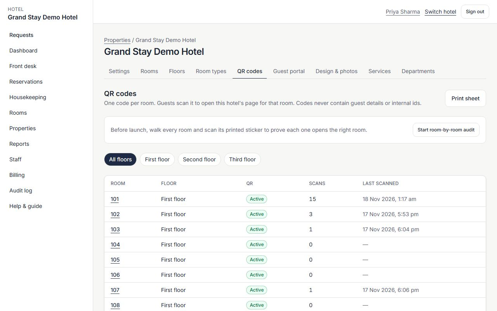
*QR codes tab: Print sheet and scan counts per room*

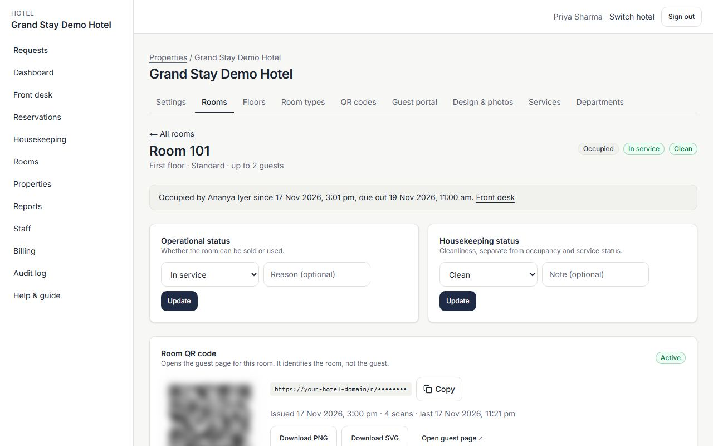
*One room's QR card: download, replace or deactivate*

### Services and menus

*Choose what guests can ask for, who receives it and how fast it must be answered.*

**Shown to:** Hotel Owner, Hotel Manager

Default services are created for you: Drinking water, Housekeeping, Reception assistance, Report a problem and Something else, plus In-room dining and Laundry menus when your plan includes ordering. Edit them in the property's **Services** tab.

| Setting | What it does |
| --- | --- |
| Name, description, icon | What the guest sees on the tile |
| Department | Which team receives the request |
| Type | Simple request, menu (items with prices) or booking |
| Choices / max quantity | Options the guest picks from, e.g. "Still / Sparkling", up to N |
| Guest note | None, optional or required |
| Priority | Low, normal, high or urgent |
| Available from / to | Hours the service can be requested (e.g. 07:00 to 23:00) |
| Target minutes | How quickly it should be accepted |
| Escalate | Flag it in red to managers if not accepted in time |
| Allow room charge | Guests can charge menu orders to their room bill |
| Message to guest | Shown after sending, e.g. "Water arrives in 10 minutes" |
| Enabled / order | Hide a service, or change its position |

For a menu service click **Menu** to add sections and items with prices.

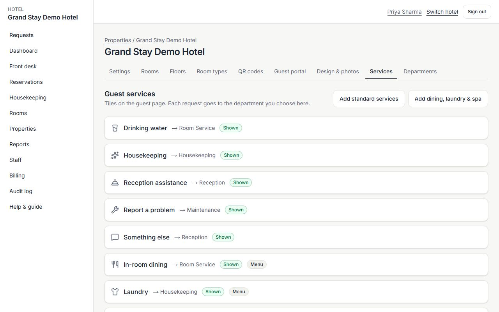
*Services tab: edit what guests can ask for*

### Guest page: information, design and photos

*What guests read after scanning, and how it looks.*

**Shown to:** Hotel Owner, Hotel Manager

**Guest portal tab**: turn the guest page on/off, show the room number, welcome message, Wi-Fi name and password, Wi-Fi note, reception phone, contact email and check-in/check-out times.

1. Open the property → **Design & photos** tab.
2. **Choose a template**: Classic (coloured header), Photo (big pictures), Elegant (luxury, serif) or Minimal (compact).
3. **Pick colours**: click a ready-made palette, or choose your own main colour and page background. Text colour adjusts itself so it stays readable.
4. **Font and gallery**: Modern or Classic font; show or hide the photo gallery.
5. Check the phone-sized **Live preview** on the right, then click **Save design**.
6. **Photos**: upload a logo, a cover photo, up to 20 gallery photos (add captions, reorder with the arrows) and an optional photo for each service.

> **Tip:** Photos straight from a phone are fine: they are resized automatically before upload. JPG, PNG and WebP are accepted.

▶ **[Video: trying templates and colour palettes with the live preview](../public/guide/video-design.webm)** (video, no sound)

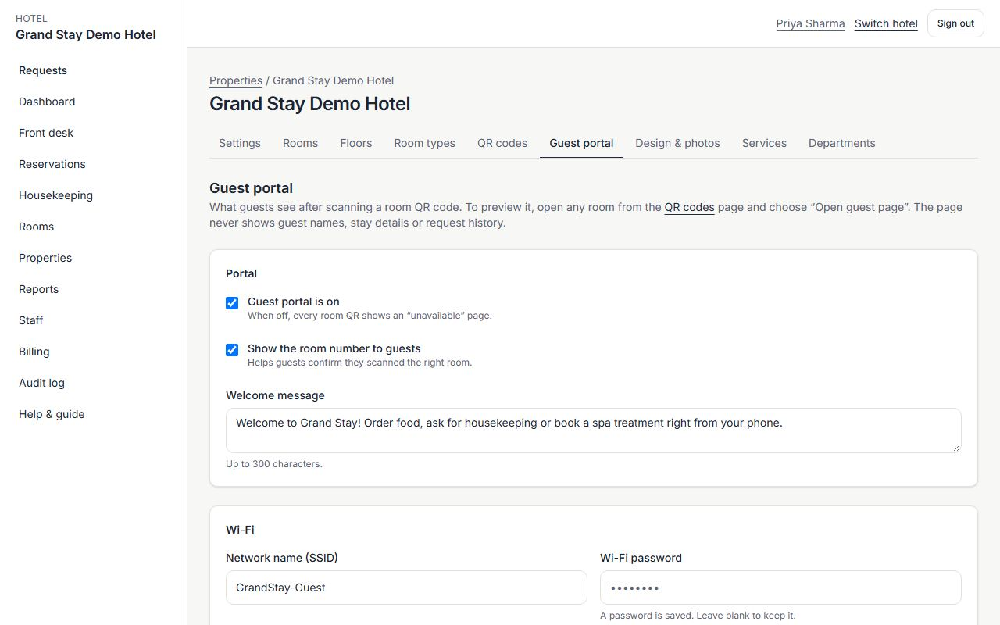
*Guest portal tab: Wi-Fi, contacts and times*

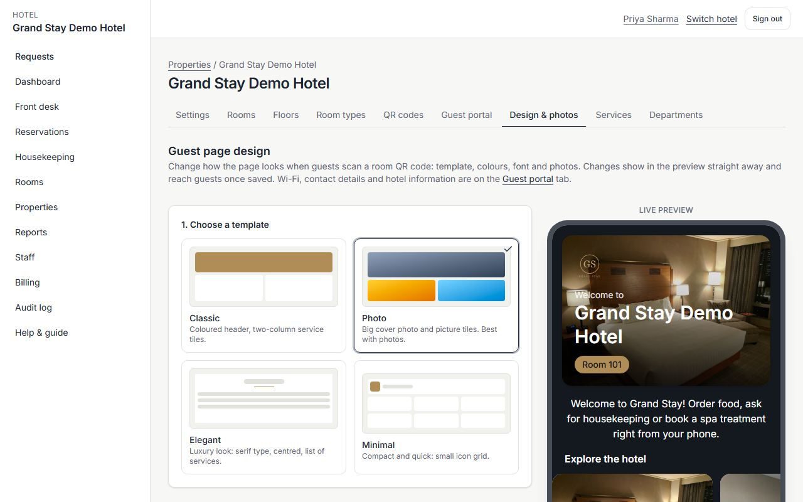
*Design & photos tab with the phone preview*

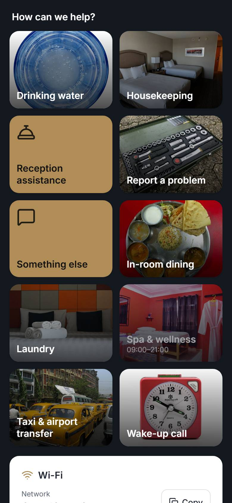
*Result: service tiles with photos on the guest page*

### Staff and roles

*Give every team member their own login with only the access they need.*

**Shown to:** Hotel Owner, Hotel Manager

1. Open **Staff** and fill in **Invite a staff member**: name, email, role and property.
2. Copy the invitation link and send it to the person (WhatsApp or email).
3. They open the link, choose a password and sign in.

| Role | Can do |
| --- | --- |
| Hotel Owner | Everything, including billing and hotel settings |
| Hotel Manager | Property operations, staff oversight, reports and escalations |
| Receptionist | Rooms, check-in/out, reservations, bills, reception requests |
| Housekeeping | Housekeeping board and cleaning requests |
| Room Service | Food and drink requests |
| Maintenance | Repairs and problem reports |
| Security | Security and emergency requests |

- Open a person to change their role or **Deactivate** them when they leave (they are signed out at once). **Reactivate** undoes it.
- Unused invitations can be revoked from the Staff page.
- **Staff → Roles** shows exactly what each role may do.
- A hotel always keeps at least one active Hotel Owner.

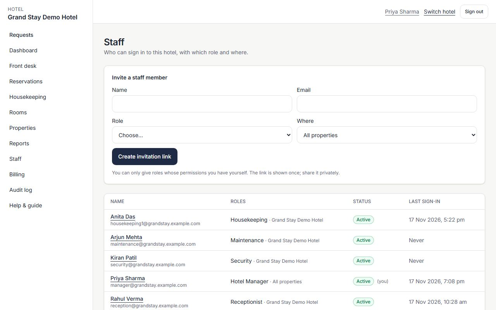
*Staff page: invite form and team list*

---

## Daily work

### Reservations

*Take bookings by room type; the system prevents overbooking.*

**Shown to:** Hotel Owner, Hotel Manager, Receptionist

1. Open **Reservations** → **New booking**: guest name, room type, arrival, departure, guests, optional contact, where it was booked and an external reference.
2. The **Availability calendar** shows how many rooms of each type are free per night.
3. The room is chosen at check-in, unless you assign one in advance.
4. On arrival day the booking appears under **Arrivals** on the Front desk.

| Status | When |
| --- | --- |
| Confirmed | Booking created |
| Checked in | Guest checked in |
| Completed | Guest checked out |
| Cancelled | Staff cancelled it (reason required) |
| No-show | Automatically overnight if not checked in by the end of arrival day, or marked by staff |

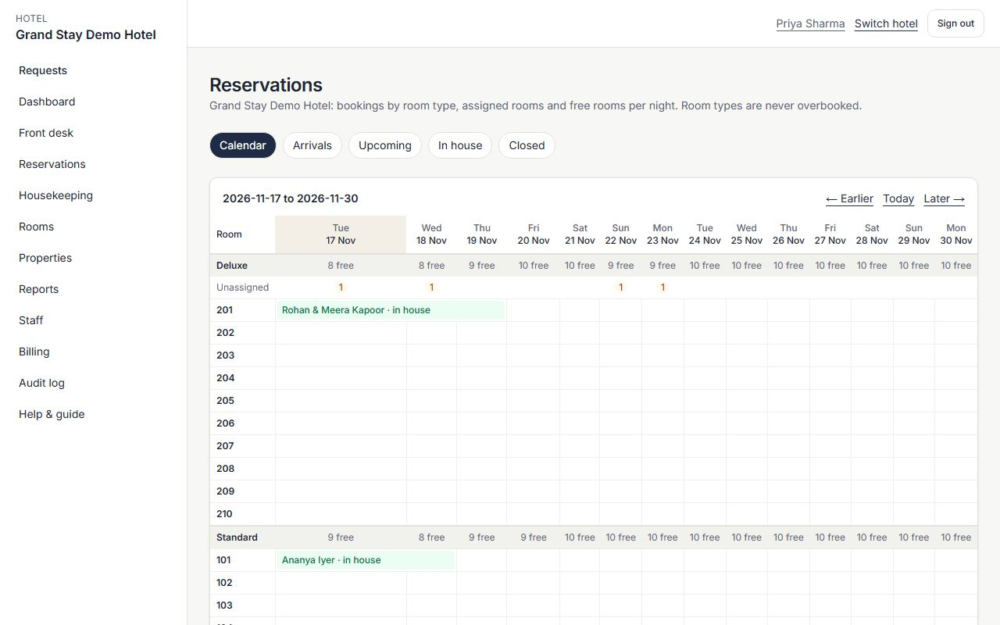
*Reservations: new booking and availability*

### Check-in and check-out

*Front desk: arrivals, walk-ins, in-house guests and departures.*

**Shown to:** Hotel Owner, Hotel Manager, Receptionist

1. **Booked guest**: Front desk → Arrivals → **Check in**, then pick a Ready room.
2. **Walk-in guest**: fill in **Walk-in check-in**: room, guest name, optional phone/email, guests, checkout date and time, staff-only notes.
3. The guest now appears under **In-house guests**, and their room shows **Occupied**.
4. **Check-out**: click **Check out** on the guest's row and confirm. If the bill isn't settled, settle it first or tick the option to leave it open.
5. After check-out the room becomes **Needs cleaning** and a cleaning task appears on the Housekeeping board automatically.

> **Tip:** Only Ready rooms can be chosen: in service, empty, cleaned and (if required) inspected. A room missing from the list is not ready yet.

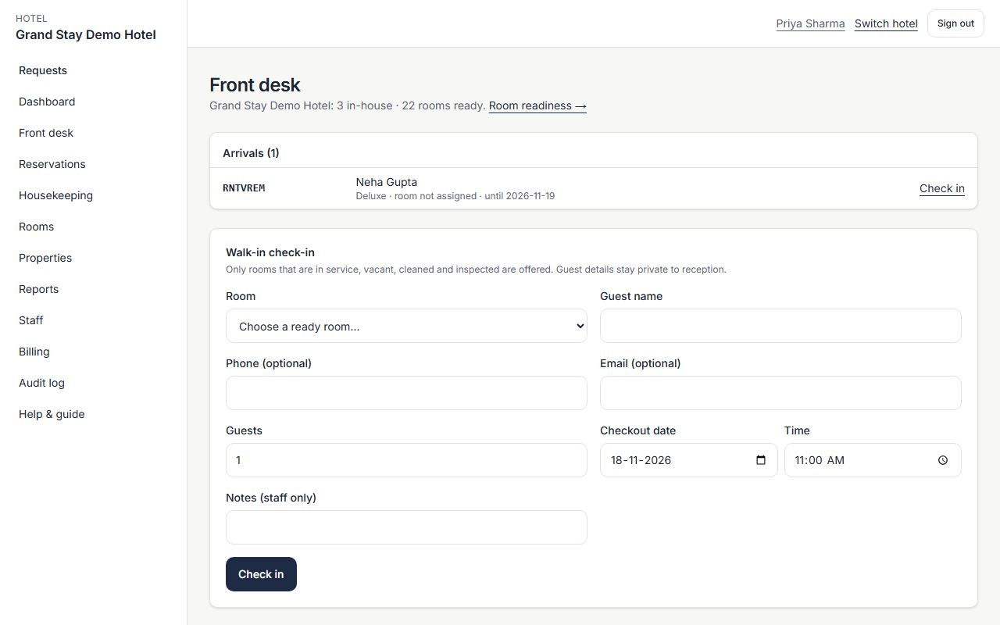
*Front desk: arrivals and walk-in check-in*

Open in the app: [Open Front desk](https://hotel-qr-code-saas.vercel.app/front-desk)

### Guest bills and orders

*Room charges from food and laundry orders, extra charges and payments.*

**Shown to:** Hotel Owner, Hotel Manager, Receptionist

- When a checked-in guest orders from a menu and chooses **charge to room**, the order is added to their bill automatically.
- Open the bill from the Front desk (in-house guest row). It shows **Charges**, **Payments** and **Balance due**.
- Use **Add charge** for extras (minibar, late checkout) and **Record payment** for cash, card or UPI received.
- Orders marked **pay on delivery** are collected by the delivering staff and are not added to the bill.

### Handling guest requests

*Accept, start and complete requests; the guest sees every step.*

**Shown to:** Everyone

1. Open **Requests** (top of the menu). The badge shows how many requests are new; a red badge means some are **Escalated** (not accepted in time).
2. Open a request to see the room, service, choices, quantity, guest note and order lines.
3. Click **Accept** so the guest knows the team has it.
4. Click **Start** when someone is on the way, then **Complete** when it's done.
5. Managers can **Assign** a request to a specific staff member.
6. **Cancel** or **Reopen** need a reason. Add a message for the guest if helpful.

| Staff sees | Guest sees |
| --- | --- |
| New | Request sent |
| Accepted | Hotel team notified |
| In progress | Being handled |
| Completed | Completed |
| Cancelled | Cancelled – please contact reception |
| Reopened | Being reviewed |

> **Tip:** Turn on phone notifications in **My profile** to get an alert for every new request you can see, or only those assigned to you.

▶ **[Video: Accept → Start → Complete a request](../public/guide/video-staff-request.webm)** (video, no sound)

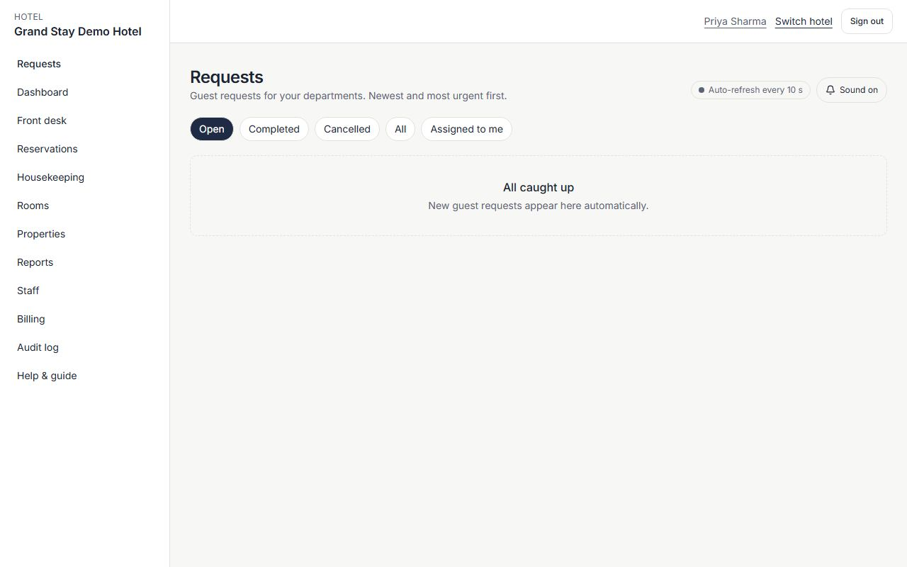
*Requests list*

Open in the app: [Open Requests](https://hotel-qr-code-saas.vercel.app/inbox) · [Notification settings](https://hotel-qr-code-saas.vercel.app/profile)

### Housekeeping

*Clean rooms after checkout and get them Ready again.*

**Shown to:** Hotel Owner, Hotel Manager, Receptionist, Housekeeping

1. Open **Housekeeping**. Rooms waiting for work are under **To do**.
2. Click **Start cleaning** when you begin, then **Done** when finished.
3. If inspection is required, a supervisor checks the room and clicks **Pass**. The room becomes **Ready**. A failed inspection sends it back for cleaning.

Managers can switch **Require inspection after cleaning** on or off at the top of the page.

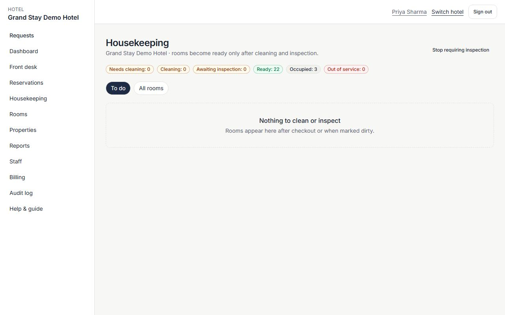
*Housekeeping board*

Open in the app: [Open Housekeeping](https://hotel-qr-code-saas.vercel.app/housekeeping)

### Room statuses (automatic)

*Room status moves by itself as staff work. Nobody sets it by hand.*

**Shown to:** Everyone

| Status | Caused by | Next step |
| --- | --- | --- |
| Ready | Cleaned (and inspected if required), empty, in service | Check-in → Occupied |
| Occupied | Guest checked in | Check-out → Needs cleaning |
| Needs cleaning | Guest checked out (cleaning task created) | Start cleaning |
| Cleaning | Housekeeper started | Done |
| Awaiting inspection | Cleaning done, inspection required | Pass → Ready |
| Out of service | Room set to Out of order / Maintenance / Inactive | Set back to Active |

Staff pages refresh themselves every 30 to 60 seconds, so everybody sees the same status.

### What the guest sees

*The guest's side, so you can explain it at check-in.*

**Shown to:** Everyone

1. Scan the room QR code with the phone camera. Your hotel page opens in your design.
2. Read the welcome, Wi-Fi details, phone numbers and times; swipe the photos.
3. Tap a service, choose options, add a note and tap **Send**.
4. Watch the status page update: Request sent → Hotel team notified → Being handled → Completed.
5. Order food or laundry and pay on delivery, or charge it to the room while checked in.

> **Tip:** Tell guests at check-in: "Scan the code by your bed for Wi-Fi, water, towels, food or anything else."

▶ **[Video: a guest scans and sends a request](../public/guide/video-guest-request.webm)** (video, no sound)

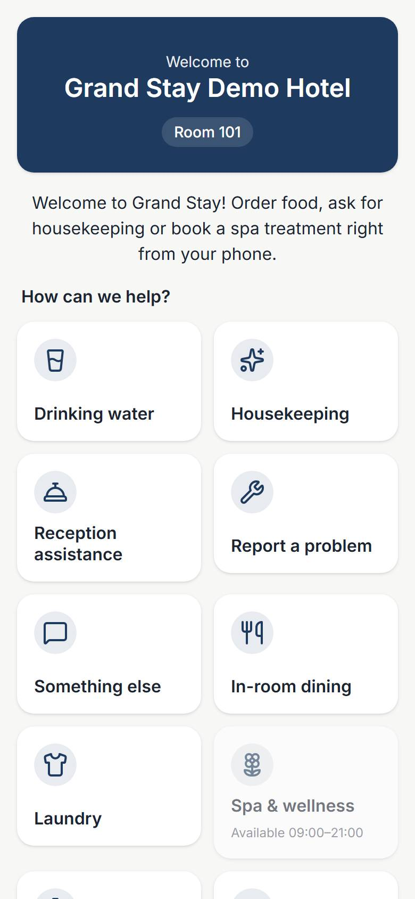
*Guest page after scanning*

*Service tiles with photos*

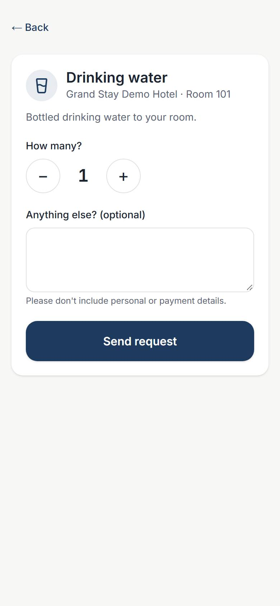
*Request form*

---

## Manage the business

### Reports and audit log

*Response times, occupancy, revenue and who did what.*

**Shown to:** Hotel Owner, Hotel Manager

- **Reports**: requests by department, average acknowledgement and completion time, missed targets, occupancy, revenue, requests completed and rooms cleaned per staff member.
- **Portfolio** (several properties): compare properties side by side.
- **Audit log**: every important change, who made it and when. Guest personal details are never written there.

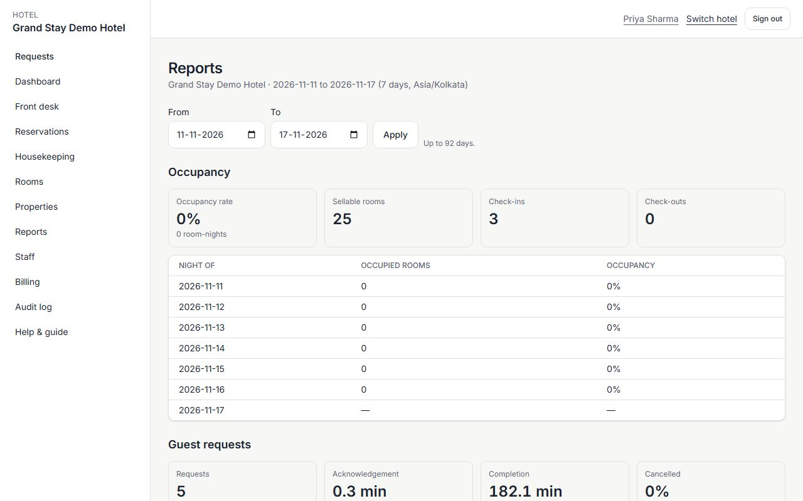
*Reports page*

### Your plan and account status

*Trial, paid, past due and suspended explained.*

**Shown to:** Hotel Owner, Hotel Manager

| Status | Meaning | Can you work? |
| --- | --- | --- |
| Trialing | Free trial (14 days from first use) | Yes |
| Active | Paid | Yes |
| Past due | Trial or paid period ended, 7-day grace | Yes, with a warning |
| Suspended | Grace ended, or suspended by the platform | Read-only; guests can't send requests |
| Cancelled | Account closed | Read-only |

The **Billing** page shows your plan, its limits (properties, rooms, staff seats) and receipts. To pay or change plan, contact the platform team; they mark your account paid after a bank transfer or cash payment. Nothing is deleted while suspended.

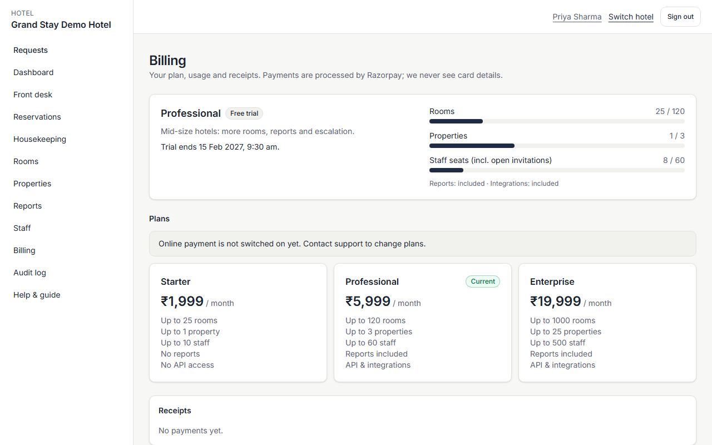
*Billing page: plan, limits and receipts*

### Hotel settings and integrations

*Company details, data export, API keys and webhooks.*

**Shown to:** Hotel Owner

- **Hotel settings**: hotel display name, legal / business name and contact email.
- **Export your data**: download your hotel's data.
- **Integrations** (on plans that include it): create API keys and webhooks to connect your PMS or other tools. A key is shown once: copy it straight away.

---

## Your account

### Your profile, password and notifications

*Change your password, turn on two-step sign-in and choose alerts.*

**Shown to:** Everyone

- Click your name at the bottom of the menu to open **My profile**.
- **Change password**: current password, then the new one (at least 10 characters).
- **Two-step sign-in**: add an authenticator app for extra safety.
- **Notifications**: phone alerts for new requests, only assigned ones, escalations, and WhatsApp alerts when enabled. Use **Test notification** to check.
- Working for more than one hotel? Use **Switch hotel** to change between them.

> **Important:** Never share your login. Each person needs their own account so the audit log stays accurate.

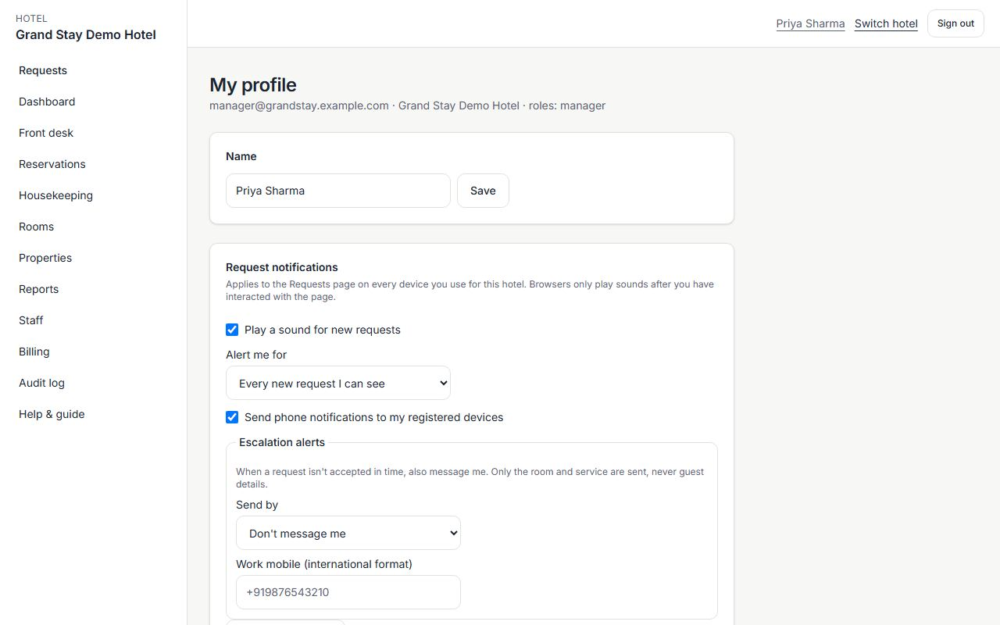
*My profile: password, two-step sign-in and notifications*

---

## Help

### Problems and quick fixes

*The most common questions from hotel teams.*

**Shown to:** Everyone

| Problem | Fix |
| --- | --- |
| Guest sees "unavailable" after scanning | The code was replaced or deactivated, the guest page is off, or the account is suspended. Check the room's QR card and the Guest portal tab. |
| A room is missing at check-in | It isn't Ready. Finish cleaning/inspection on Housekeeping or set the room back to Active. |
| I don't see some requests | Your role or property doesn't cover that department. Ask the owner to check Staff → your name. |
| Forgot password | Ask your hotel owner or the platform team for a reset link. |
| Photo upload fails | Use JPG, PNG or WebP. The gallery holds up to 20 photos. |
| "Read-only" message | The account is suspended or past grace. The owner should check Billing. |
| Request count doesn't change | Pages refresh every 10 to 30 seconds. Reload if needed. |
