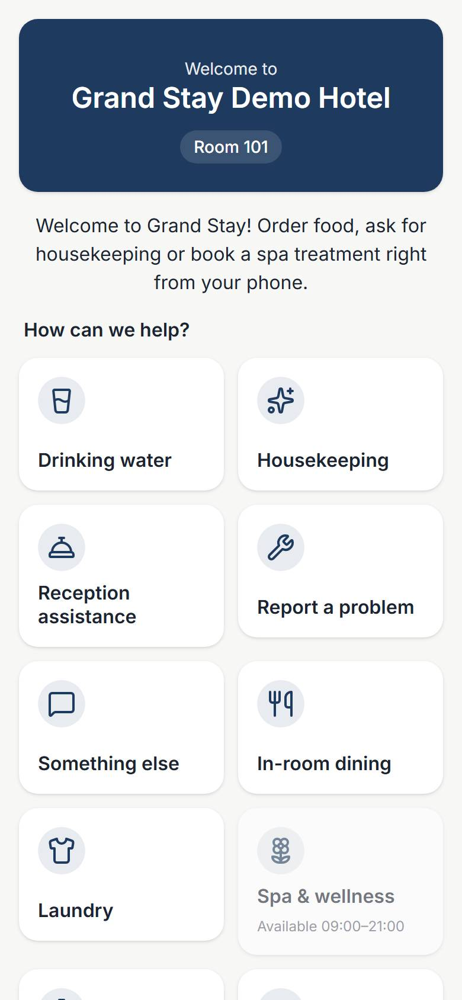
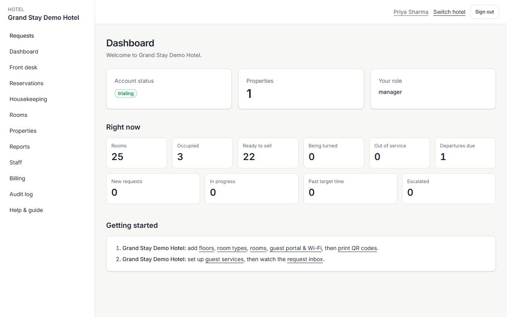

# Super admin guide

How to run the platform: create and manage hotels, plans, payments, users and support. The same guide is inside the app (Docs & guide).

<!-- Generated from modules/help/content.ts by `pnpm guide:md`. Edit the content there, not here. -->

## Where to start

1. [Secure your login](#platform-first-setup) — Two-step sign-in
2. [Create a hotel](#platform-create-hotel) — Or let it sign up
3. [Set the plan & status](#platform-account-status) — Trial, paid, suspended
4. [Help a hotel](#platform-enter-hotel) — Log in as admin or guest
5. [Support people](#platform-support) — Resets and blocks

## Contents

- **Start here**
  - [What the super admin does](#platform-overview)
  - [First sign-in and two-step sign-in](#platform-first-setup)
- **Hotels**
  - [Create a hotel](#platform-create-hotel)
  - [Manage a hotel](#platform-manage-hotel)
  - [Account status: trial, paid, suspended](#platform-account-status)
  - [Enter any hotel (admin, read-only, guest)](#platform-enter-hotel)
- **People**
  - [Users and super admins](#platform-users)
  - [Support: passwords and lost phones](#platform-support)
- **Business**
  - [Plans and limits](#platform-plans)
  - [Audit log](#platform-audit)
  - [Going-live checklist](#platform-go-live)

---

## Start here

### What the super admin does

*You run the platform: every hotel, plan, login and payment.*

| Console page | What it's for |
| --- | --- |
| Overview | Totals: hotels by status, users, requests, recent activity |
| Hotels | Search and filter all hotels, create a new hotel, manage each one |
| Users & staff | Every login on the platform: block/unblock, make or remove super admins |
| Plans | Plan prices and limits (properties, rooms, staff, modules) |
| Audit log | Every super admin action with its reason and time |
| Support | Password reset links and two-step sign-in resets |
| Docs & guide | This guide, plus the full hotel guide |

> **Important:** Every super admin action is audited. Always give a real reason: it is what you will read later when something is questioned.

### First sign-in and two-step sign-in

*The console only opens after two-step sign-in is set up.*

1. Sign in at /login with the super admin email and password. You are sent to the console.
2. The first time, you are asked to set up two-step sign-in (Security link at the top).
3. Scan the QR code with Google Authenticator, Microsoft Authenticator or Authy and type the 6-digit code.
4. From now on every sign-in asks for the code after your password.

> **Tip:** Create a second super admin (Users & staff → Make super admin). A super admin can't reset their own two-step sign-in, so a second one can rescue a lost phone.

Open in the app: [Open Security](https://hotel-qr-code-saas.vercel.app/account/security)

---

## Hotels

### Create a hotel

*Hotels can sign up themselves, or you create them for the owner.*

**Self sign-up**: the owner opens /signup, enters their name, work email, password, hotel name and legal name, and starts a free trial at once.

1. **Created by you**: Hotels → **New hotel**.
2. Enter hotel display name, legal / business name, plan, owner name and owner email.
3. Click **Create**. A one-time link is shown.
4. Send the link privately to the owner. They choose their own password and sign in as Hotel Owner.
5. Point them to **Help & guide** in their menu: the setup checklist takes them through the rest.

Open in the app: [Create a hotel](https://hotel-qr-code-saas.vercel.app/platform/tenants/new)

### Manage a hotel

*Everything about one hotel lives on its Manage page.*

1. Hotels → search by name or filter by status → **Manage**.
2. See its plan, status, trial end, properties, rooms, staff and recent activity.
3. **Edit hotel details** (names, contact) from the bottom card.
4. Change plan, extend the trial, mark as paid or suspend from the subscription and status cards (see the next section).
5. Deactivate or reactivate a staff member of that hotel from its staff list (the last owner can't be removed).

Open in the app: [Open Hotels](https://hotel-qr-code-saas.vercel.app/platform/tenants)

### Account status: trial, paid, suspended

*What each status means and how to change it.*

| Status | Meaning | Hotel can work? |
| --- | --- | --- |
| Trialing | Free trial (14 days from first use) | Yes |
| Active | Paid | Yes |
| Past due | Period ended, 7-day grace | Yes, with a banner |
| Suspended | Grace over, or you suspended it | Read-only; guests can't send requests |
| Cancelled | Closed | Read-only |

| To do this | On the hotel's Manage page | Result |
| --- | --- | --- |
| Record a payment (cash, bank, free) | Mark as paid: days + receipt/reason → Activate | Active for those days |
| Give more trial time | Extend free trial: 1 to 90 days + reason | Still Trialing, later end |
| Change package | Change plan + reason | New plan, same status |
| Block the hotel | Suspend hotel | Suspended, nothing deleted |
| Unblock | Reactivate | Back to what the subscription allows |

Statuses also change on their own: trial ends → Past due → after 7 days Suspended; a payment makes it Active.

> **Tip:** Online payment (Razorpay) is built but switched off until Razorpay keys are added. Until then, use Mark as paid.

### Enter any hotel (admin, read-only, guest)

*Help a hotel by working inside its account, or test a room as a guest.*

| Button on the Manage page | What you get | Banner |
| --- | --- | --- |
| Log in as hotel admin | Full owner-level access for 1 hour | Red |
| View hotel (read-only) | See every screen, change nothing, 1 hour | Yellow |
| Open as a guest | List of every room; tap one to open its real guest page | None |

1. Type a short reason (for example "Owner asked to fix room types") and click the button.
2. Work in the hotel as usual. Every change is recorded under your name.
3. Click **Exit to super admin** in the banner when done. Signing out also ends it; it ends by itself after 1 hour.

> **Important:** Requests sent from a guest page reach the hotel's real staff. Use "Something else" with a note like "Test from support".

*What you see with Open as a guest (room page)*

*A hotel's workspace after Log in as hotel admin*

---

## People

### Users and super admins

*Every login on the platform, across all hotels.*

- Search by name or email; see each person's hotels, roles and last sign-in.
- **Block login** signs a person out everywhere and stops them signing in. **Unblock login** undoes it. You can't block yourself.
- **Make super admin** / **Remove super admin** controls who can open this console.

Open in the app: [Open Users & staff](https://hotel-qr-code-saas.vercel.app/platform/users)

### Support: passwords and lost phones

*Recover access safely.*

1. Confirm who is asking, outside the system: call the hotel's known number, or the owner confirms.
2. **Forgot password**: Support → create a reset link (valid 1 hour, single use) and send it privately.
3. **Lost authenticator**: Support → **Reset two-step sign-in**. They set it up again at next sign-in.

Open in the app: [Open Support](https://hotel-qr-code-saas.vercel.app/platform/support)

---

## Business

### Plans and limits

*What each plan includes.*

The **Plans** page lists each plan with its price and limits: properties, rooms, staff seats and modules (ordering, integrations…). A hotel over its limit can keep working but can't add more until it upgrades.

Open in the app: [Open Plans](https://hotel-qr-code-saas.vercel.app/platform/plans)

### Audit log

*A permanent record of what super admins did.*

Every hotel created, plan changed, payment marked, suspension, user blocked, reset link and hotel entry is listed with who, when and the reason. Changes made inside a hotel while logged in as its admin also appear in that hotel's own audit log.

Open in the app: [Open Audit log](https://hotel-qr-code-saas.vercel.app/platform/audit)

### Going-live checklist

*Do these before the first paying hotel.*

- Change every demo or shared password.
- Rotate the database password and keep a separate database for previews.
- Add a custom domain **before** printing QR codes (printed codes keep their address).
- Add Razorpay keys and set real plan prices.
- Optional: SMS/WhatsApp alerts (Twilio) and an email provider for invitations.
- Upload real photos and a design for each demo hotel you show customers.
