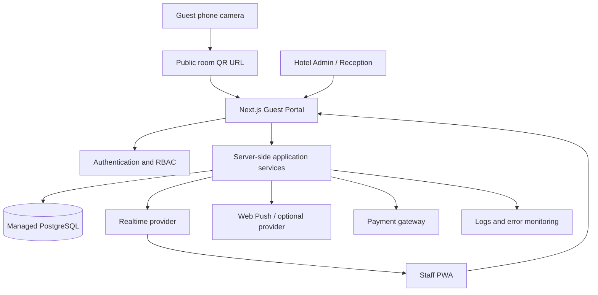
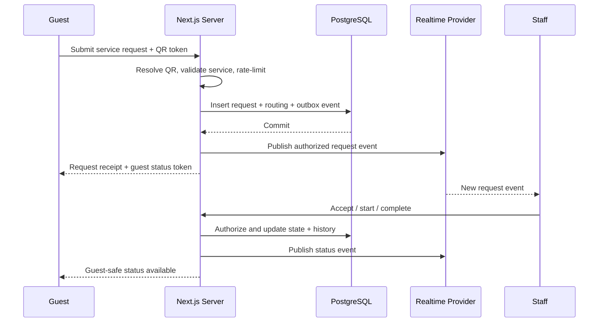

# System Architecture

## 1. Architecture overview

Use a modular monolith initially: one Next.js codebase with clear domain modules, server-side services and API boundaries. This avoids premature microservice complexity while keeping domains separable.



## 2. Application layers

- **Presentation:** guest portal, staff PWA, hotel admin, SaaS operator console.
- **Authentication:** staff/admin identities, sessions, password reset and optional MFA.
- **Authorization:** tenant/property/department scope and permission checks.
- **Domain services:** rooms, QR, stays, requests, housekeeping, notifications, billing.
- **Persistence:** PostgreSQL with migrations and tenant-aware repository/service methods.
- **Realtime:** provider broadcasts authorized events; database remains source of truth.
- **Integrations:** payment, email, SMS, web push, analytics and monitoring.

## 3. Suggested repository layout

```text
hotel-saas/
  app/
    (marketing)/
    (auth)/
    (saas-admin)/
    (hotel-admin)/
    (staff)/
    guest/[token]/
    api/
  components/
    ui/
    layout/
    guest/
    rooms/
    requests/
    staff/
  modules/
    tenants/
    properties/
    rooms/
    qr/
    guests/
    stays/
    services/
    requests/
    housekeeping/
    notifications/
    billing/
    reports/
    audit/
  lib/
    auth/
    db/
    permissions/
    validation/
    realtime/
    rate-limit/
    crypto/
    observability/
  prisma/ or drizzle/
    schema/
    migrations/
  public/
  tests/
    unit/
    integration/
    e2e/
  docs/
```

## 4. Request lifecycle sequence



## 5. Realtime reliability pattern

Persist first, publish second. Prefer a transactional outbox:
- Create request and outbox event in the same database transaction.
- A worker/cron or provider-triggered process publishes pending events.
- Mark event delivered; retry with bounded exponential backoff.
- Consumers deduplicate using event ID.
- Staff inbox always queries persisted requests, so reconnects recover missed events.

Vercel serverless functions are not durable background workers. Do not depend on a process remaining alive after the response. Use a managed queue/workflow or scheduled invocation for outbox processing if required by scale and provider guarantees.

## 6. Deployment boundaries

- Vercel: Next.js application, server-rendered pages, API routes/server actions and preview deployments.
- Neon (or equivalent): managed PostgreSQL.
- Ably/Pusher: realtime event transport.
- Vercel Blob or compatible object storage: hotel logos and assets.
- Razorpay: India-focused payment gateway, subject to account and webhook setup.
- Sentry: error monitoring.
- Email/SMS/push providers: optional channels.

## 7. Architectural decisions

- Start with modular monolith; extract services only when justified by load/team boundaries.
- Use PostgreSQL rather than trying to host a persistent database inside Vercel.
- Use opaque QR tokens and guest request tokens.
- Use server-side permission checks for every protected action.
- Use a transaction plus outbox for durable event publication.
- Store timestamps in UTC; display in property timezone.
- Use database migrations in CI/CD and review destructive migrations.
