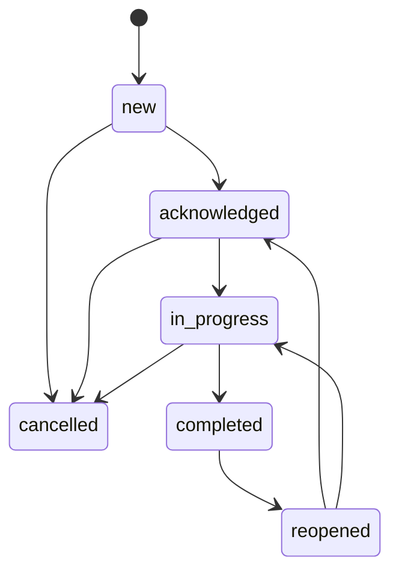

# Request State Machine

## States

- `new`: persisted and waiting for staff acknowledgement.
- `acknowledged`: staff member or department has accepted responsibility.
- `in_progress`: work has started.
- `completed`: service fulfilled.
- `cancelled`: request cancelled with reason.
- `reopened`: completed request reopened by authorized staff or guest policy.

## Allowed transitions

## Transition rules

| From | To | Actor | Conditions |
|---|---|---|---|
| new | acknowledged | eligible staff/manager | Department or assignment access |
| new | cancelled | manager/reception; guest only under policy | Reason recorded |
| acknowledged | in_progress | assignee/eligible staff | Permission and scope |
| acknowledged | cancelled | manager/authorized staff | Reason recorded |
| in_progress | completed | assignee/manager | Completion timestamp |
| in_progress | cancelled | manager/authorized staff | Reason recorded |
| completed | reopened | manager/authorized staff | Reopen reason and audit |
| reopened | acknowledged/in_progress | eligible staff | Reassignment or work resumes |

## Required history

Every transition records request ID, tenant ID, from/to status, actor, timestamp, reason/note and source (staff/admin/system/guest). Status changes must be performed in a transaction and validated against allowed transitions.

## Guest-visible status mapping

Internal states map to a simpler guest view:
- `new` → Request sent.
- `acknowledged` → Hotel team notified.
- `in_progress` → Being handled.
- `completed` → Completed.
- `cancelled` → Cancelled / contact reception.
- `reopened` → Being reviewed.

Do not show internal notes, staff phone numbers or escalation details to guests.
